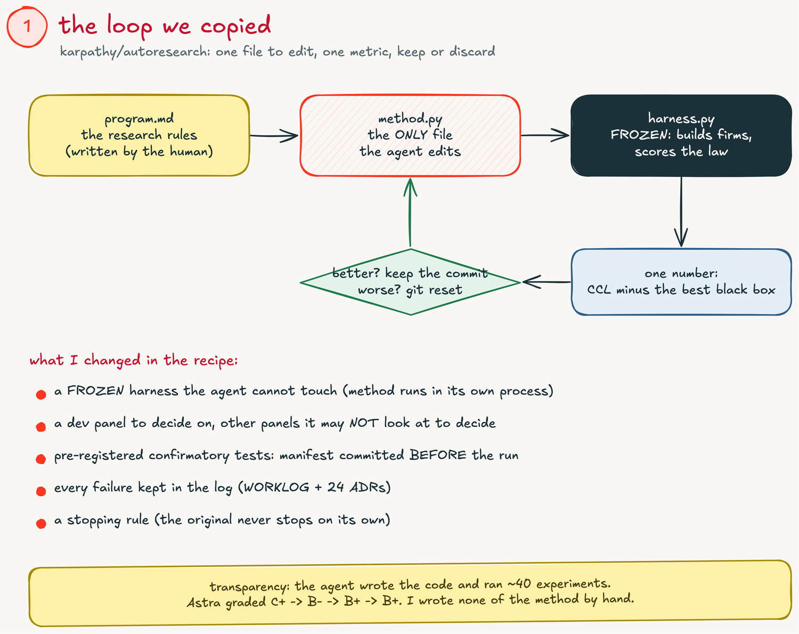
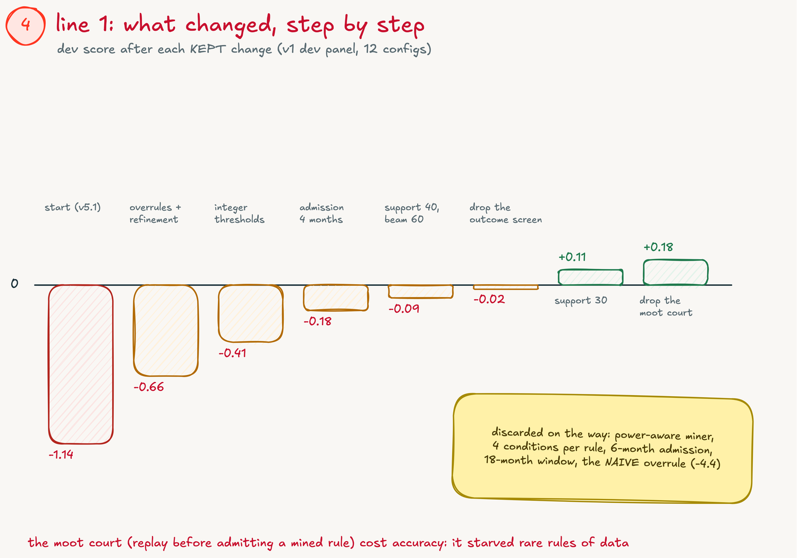
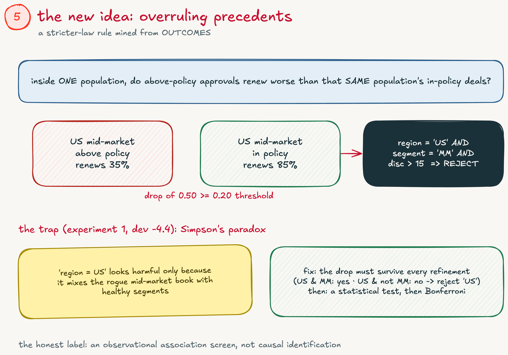
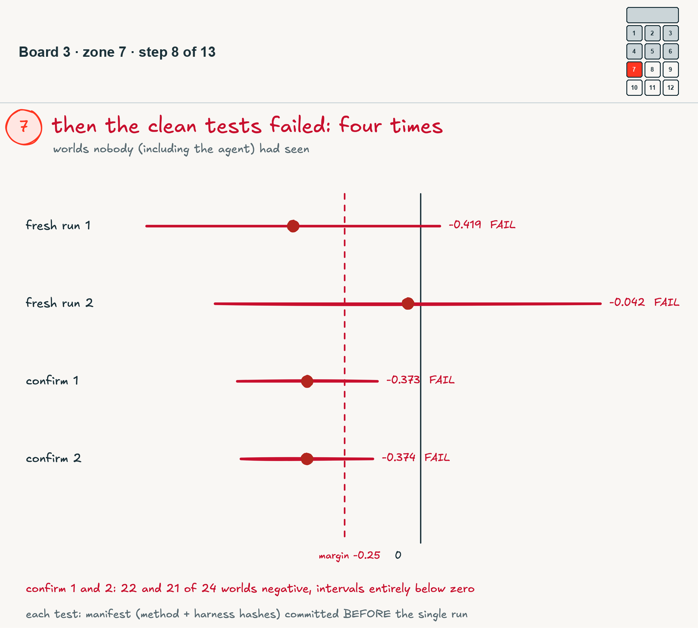
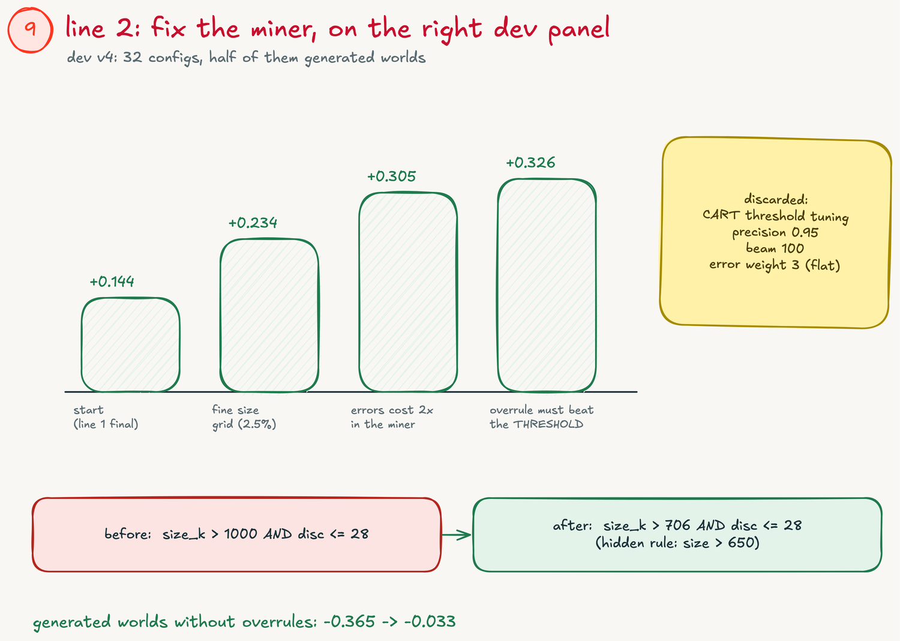
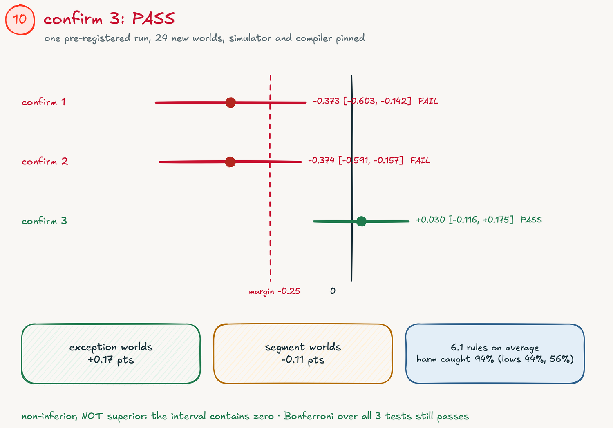
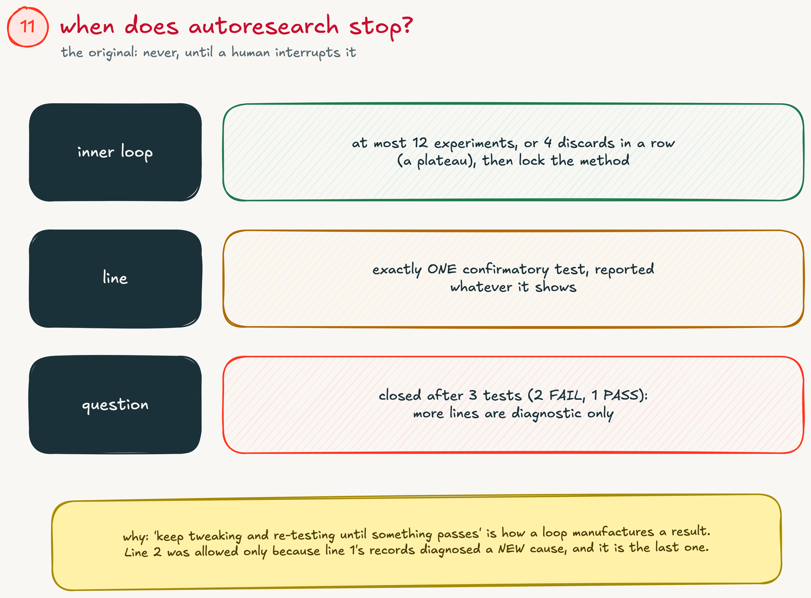
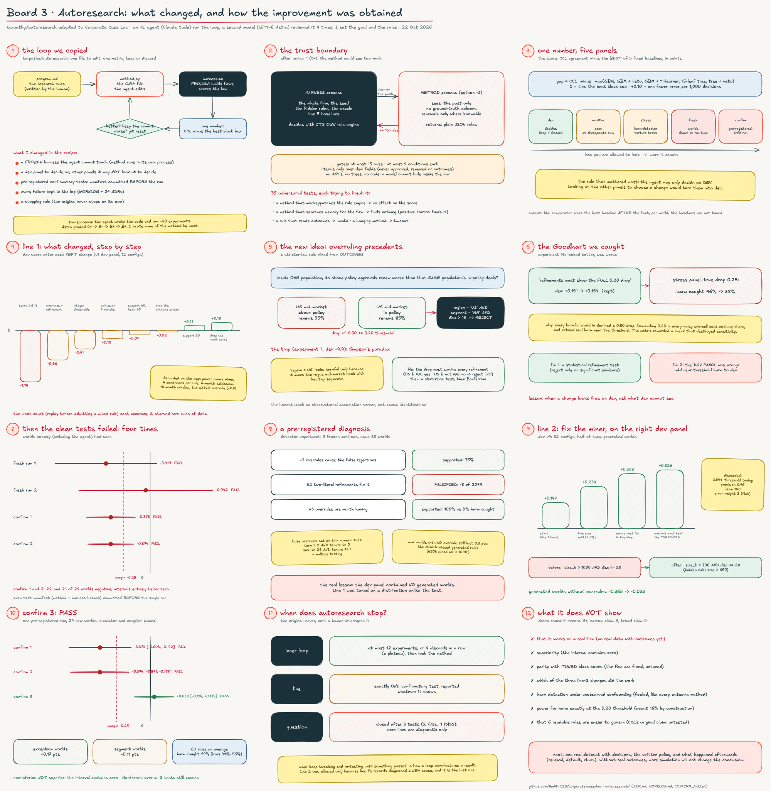

# I let an AI run my research loop. Here is where it took my research.

*Part 2 of Corporate Case Law. Code and every number: github.com/HadiFrt20/corporate-case-law*

---

## Where the research stood

In part 1 I tested an idea I call Corporate Case Law: a company's unwritten rules can be mined from its own past decisions and turned into a handful of readable rules an AI agent must follow.

It worked as a mechanism, and lost as a method. On a simulated company, a well-informed black-box model got about 3 more decisions right per 100 than my readable rules in the hardest test. The rules let some harmful deals through.

So instead of iterating by hand, I tried something new: I let an AI run the research.

## How the loop works

I borrowed the structure of Andrej Karpathy's **autoresearch** project. An AI agent edits one file, a fixed scorer it cannot touch grades the result, the change is kept if the score goes up and thrown away if it goes down, and the loop repeats.

*Figure 1. The loop: the rules of the research (written by me), the one file the agent edits, the frozen scorer, one number, keep or discard.*

To be clear about who did what:

- **An AI coding agent (Claude Code) wrote the code and ran about 40 experiments.** I did not write the method by hand.
- **A second AI model (GPT-6 Astra) reviewed the whole project four times**, looking for mistakes and for ways the agent could be fooling itself.
- **I set the goal and the rules**, and read every review.

The scorer was the important part. The agent could only see the past, could only hand back plain readable rules (at most 15), and could only use one set of simulated companies to decide what to keep. The real tests ran on companies generated fresh at test time, that neither the agent nor I had seen.

## What the loop changed

The first round of experiments moved the score step by step, from clearly losing to slightly ahead on the companies the agent was allowed to learn from.

*Figure 2. The score after each change the loop kept: from -1.14 points (part 1's method) to +0.18.*

Two of those steps matter beyond the numbers.

**It found the idea part 1 was missing.** I call it an overruling precedent, after the legal term. If, within one group of customers, deals approved above the written discount policy renew much worse than that same group's normal deals, the loop writes a rule that blocks those exceptions. In the simulated company it found exactly the rogue approver I had planted: `region = 'US' AND segment = 'MM' AND discount > 15% => REJECT`.

*Figure 3. Overruling precedents: compare exceptions with normal deals in the same group of customers. The first version was fooled by mixing groups, and had to learn to compare like with like.*

Without this rule type, the readable rules caught none of the harmful deals when the harm was strong. With it, they caught all of them.

**It overturned two of my own assumptions.** Part 1's design checked every new rule against a separate window of past decisions before accepting it. The loop removed that step as an experiment, and the score went up, with every practice company ending above zero: the check was starving rare rules of data. It also dropped an outcome check that the new rule type made unnecessary.

## Then the real tests failed

The agent's score looked good. The fresh test companies disagreed.

*Figure 4. Four tests on fresh companies, all failing the bar. The last two were registered in advance and run exactly once.*

Four tests in a row failed the bar I had set in advance: no more than 0.25 points worse than the best black box. The last two were clearly worse, not just inconclusive.

The diagnosis was humbling. The companies the agent learned from had all been written by hand. The test companies were generated automatically, with rules like "deals above 650k". The agent had been tuned on the wrong kind of company, and its rule miner could only say "above 1,000k".

## Round two: fix the miner, on the right companies

The second round started with a better setup: half of the practice companies were now generated the same way as the test ones.

*Figure 5. Round two: three changes kept, each making the mined rules more precise. The 650k rule is now found as "above 706k" instead of "above 1,000k".*

Three changes made the rules more precise:

- thresholds on a fine grid instead of round numbers;
- a mining score that penalises wrong decisions more than it rewards right ones, so precise rules beat broad ones;
- an overruling rule fires only when the harm clearly exceeds the threshold, not just when some harm exists.

Then one final test, registered in advance and run once, on 24 new companies.

*Figure 6. The three registered tests on one axis. The last one passes: the readable rules match the best black box within the margin.*

**It passed.** About 6 readable rules matched the best of five black-box models: +0.03 points, with a 95% range from -0.12 to +0.18. Part 1 had ended about 3 points behind.

## When does an AI research loop stop?

Karpathy's original never stops on its own: it runs until a human interrupts it. That is fine for training a model. For research that makes claims, it is a trap: keep tweaking and re-testing, and something eventually passes by luck.

*Figure 7. Three stopping rules: a limit on experiments per round, one final test per round, and a limit on how many times the same question can be tested.*

So the loop now stops at three levels: at most 12 experiments per round, exactly one final test per round, and the question "do readable rules match the black box?" is closed after three tests. Two failed, one passed, and all three are reported.

## What it does and does not mean

The narrow result holds: on new simulated companies of the same kind, a few readable rules match the best of five standard black-box models.

What it does not show yet: that it works on a real company, that it beats tuned models, or that six readable rules are actually easier for people to govern. That last point is the reason Corporate Case Law exists, and it is still untested.

The most useful thing the AI produced was not a better method. It was a more honest way to test one: a scorer it could not touch, tests registered before they were run, failures kept in the open, and a rule for when to stop. The method only improved once that was in place.

Next step: one real dataset with decisions, the written policy, and what happened to the customers afterwards.

*Figure 8. The full whiteboard of this project.*

---

**Code, tests and every number:** github.com/HadiFrt20/corporate-case-law (the `autoresearch/` folder). Karpathy's original: github.com/karpathy/autoresearch
