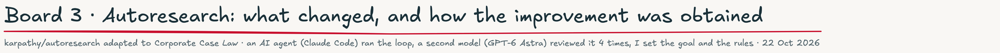
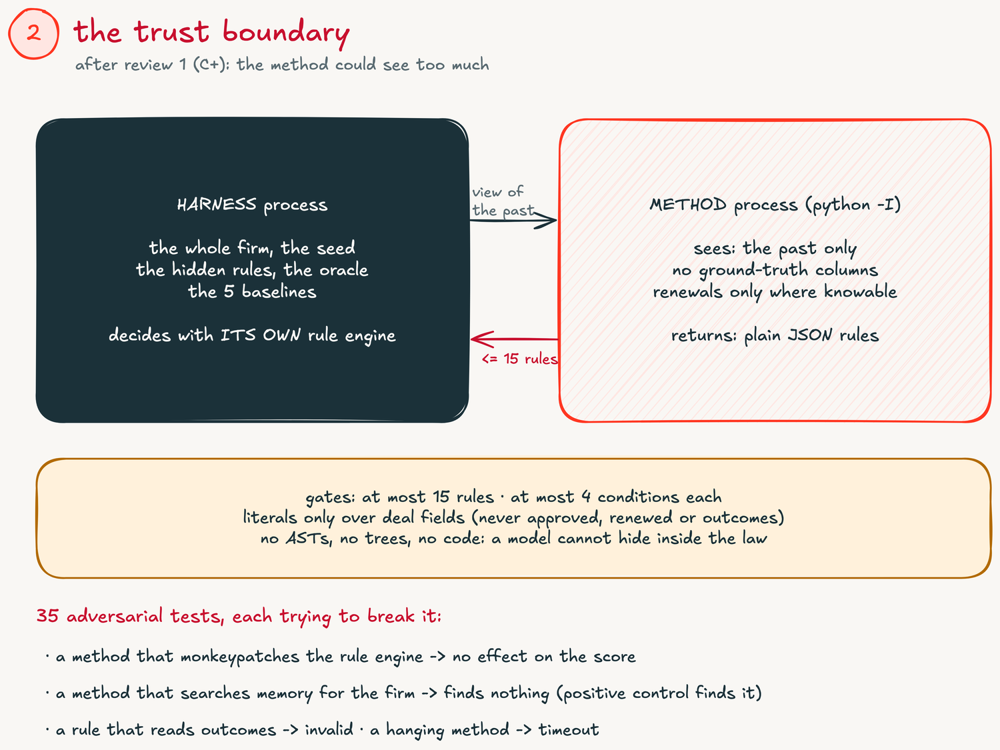
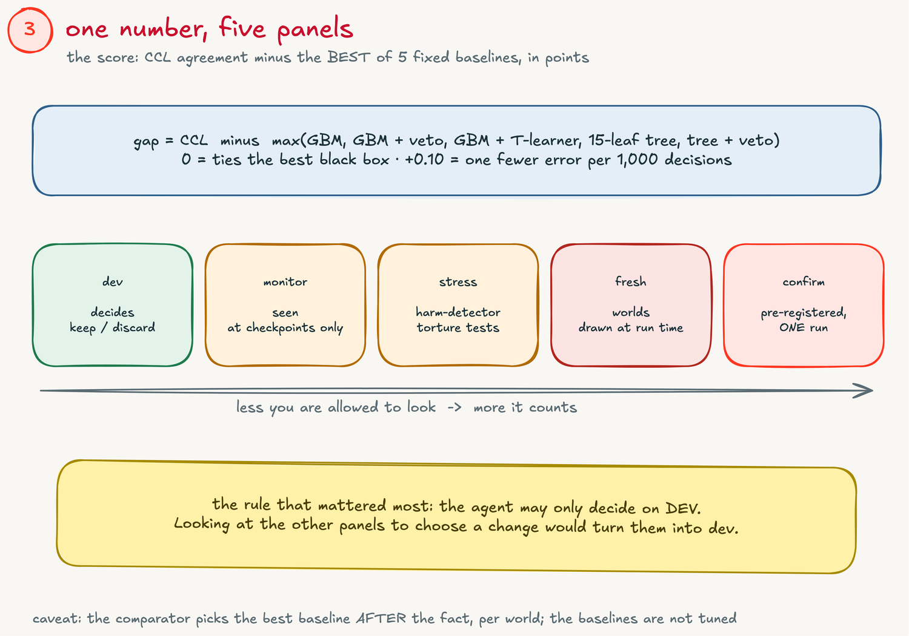
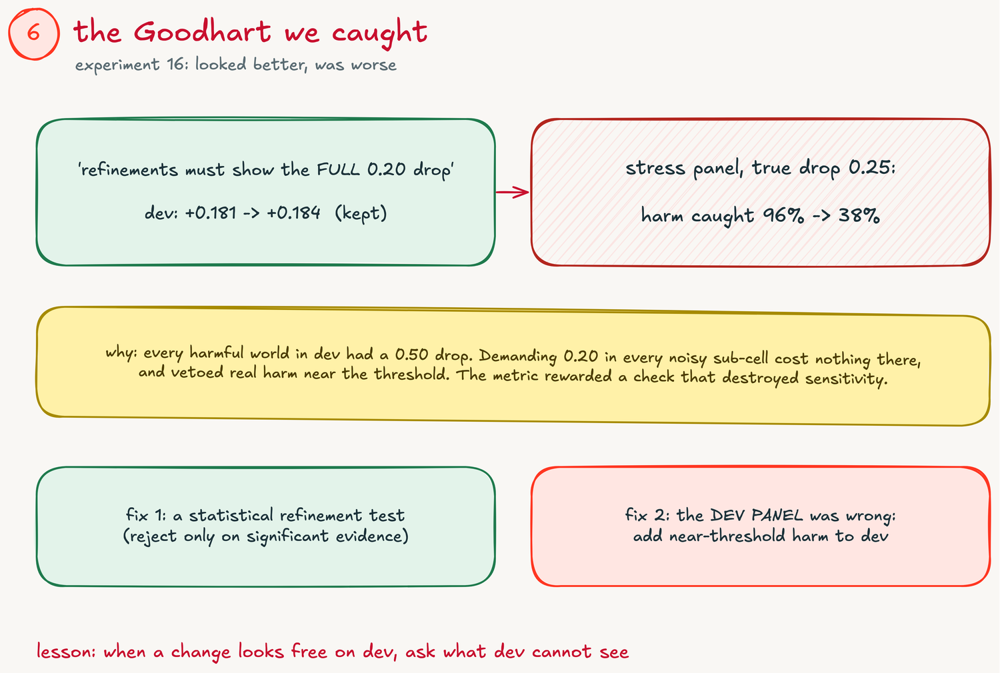
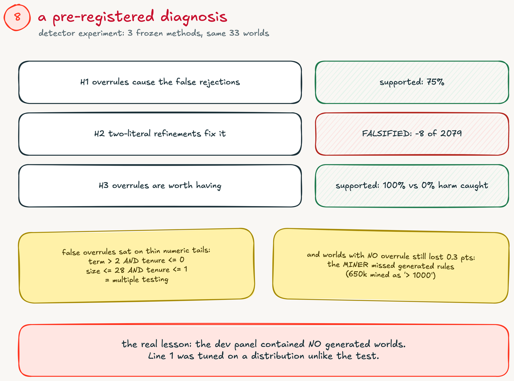
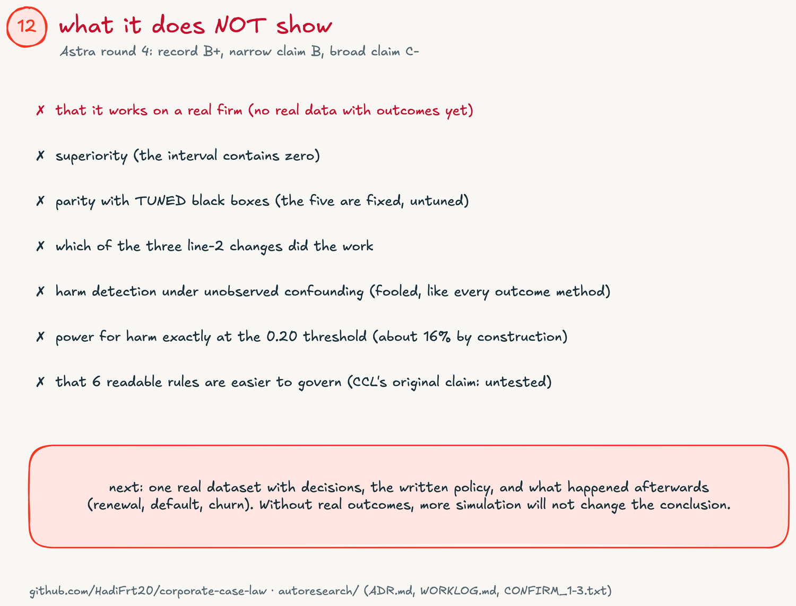

# I let an AI run my research loop. It failed four times, then passed once. Here is everything.

*Part 2 of Corporate Case Law. The method, the code, every number and every failure: github.com/HadiFrt20/corporate-case-law*

---

## The answer first

In part 1, Corporate Case Law (CCL) lost. Once every method saw the same outcome data, a well-informed black box beat my readable rules by about 3 points in the hardest test.

So I tried something I had not done before: I handed the research itself to an AI agent, inside the structure of Andrej Karpathy's **autoresearch** repo. The agent edits one file, a frozen harness scores it, the agent keeps the change if the score improves and throws it away if not, and repeats.

I want to be precise about who did what, because that is the point of this post:

- **An AI coding agent (Claude Code) wrote all the code and ran about 40 experiments.** I did not write the method by hand.
- **A second model (GPT-6 Astra, served on Databricks) reviewed the whole project four times**, aggressively, with file and line references. Its grades: C+, B-, B+, B+.
- **I set the goal, the rules and the direction**, in a handful of sentences, and I read every review.

Here is where it landed:

1. **The loop moved CCL from clearly losing to matching black boxes, on synthetic worlds.** On 24 freshly generated worlds that nobody had seen, about 6 readable rules came within the pre-registered margin of the best of five fixed black-box models: +0.030 points, 95% interval [-0.116, +0.175].
2. **It got there by failing first.** Four clean tests failed before one passed. Every failure is in the repo.
3. **The most valuable thing the loop produced was not a better method. It was a better way of testing**: a frozen harness the agent cannot touch, a rule that the agent may only decide on one panel, pre-registered tests with hashes, and a rule for when to stop.
4. **The result is narrow.** Same family of simulated worlds, untuned baselines, parity not superiority, and no real firm yet.

Each figure below is one zone of a single hand-drawn whiteboard (board 3). The full board comes at the end.

*Figure 1. Board 3, header: autoresearch adapted to Corporate Case Law, with who did what written on the board itself.*

---

## 1. Why hand research to a loop at all

Part 1 taught me something uncomfortable. My best-looking result had been an information leak, my README once carried numbers I had typed from memory, and my "fair" baseline turned out to be unfair. Every one of those was caught by a reviewer, not by me. The problem was not effort. It was that the person running the experiments was also the person who wanted them to work.

Karpathy's autoresearch is built for a different job (training a small language model overnight), but its shape solves my problem: the thing being optimized and the thing doing the scoring are separated, and the scoring cannot be edited by the optimizer.

*Figure 2. Zone 1: the loop. program.md holds the rules (human), method.py is the only file the agent edits, harness.py is frozen and returns one number. Better: keep the commit. Worse: git reset. Below: the five things I added to the recipe.*

What I added to the recipe, because a research loop that makes claims needs more than a training loop:

- a frozen harness that runs the method in a separate process;
- one panel to decide on, and other panels the agent is not allowed to look at when deciding;
- pre-registered confirmatory tests, with the method and harness hashes committed before the run;
- every failure kept, in a worklog and a log of decisions (24 of them by the end);
- a stopping rule. The original never stops on its own; it loops until a human interrupts it.

## 2. The trust boundary

The first review graded the loop C+. It did not find cheating. It found that cheating was possible: the method ran in the same process as the harness, so it could have read the hidden rules, the random seed or the answer key from memory, or quietly replaced the rule engine that scores it.

*Figure 3. Zone 2: the harness process holds the firm, the oracle and the baselines and decides with its own rule engine. The method process sees only the past and returns plain JSON rules. 35 adversarial tests try to break the boundary.*

The fix was structural. The method now runs in its own process and receives only a view of the past: no ground-truth columns, and renewal outcomes only where the firm could have known them. It can return only plain rules: at most 15, at most 4 conditions each, written over deal fields only. A rule that tries to read an outcome is invalid, and so is anything that is not a rule (no code, no trees).

Then the agent wrote tests that attack the boundary: a method that monkeypatches the rule engine (no effect on the score), a method that searches memory for the answer key (finds nothing, while the same probe run inside the harness does find it), a method that hangs (timeout). Thirty-five of them by the end. Two of the agent's own early tests were weak, and the reviewer caught both: one probe silently skipped the objects it was meant to inspect, and another checked the code against itself.

## 3. One number, five panels

*Figure 4. Zone 3: the score is CCL's agreement minus the best of five fixed baselines, in points. Five panels, from the one the agent decides on (dev) to the one it runs once (confirm).*

The score is simple: how often CCL agrees with the right decision, minus how often the best of five fixed black-box models does, per world, in points. Zero means a tie. Plus 0.10 means one fewer error per thousand decisions.

The panels are what make it honest. The agent may only decide on **dev**. A **monitor** panel is looked at occasionally. A **stress** panel tortures the harm detector. A **fresh** panel draws new worlds at run time. A **confirm** panel is pre-registered and run exactly once. The rule that mattered most: looking at a panel to choose a change turns that panel into dev.

One caveat that stays true all the way through: the comparator picks the best baseline after the fact, per world, and the baselines are not tuned. That makes CCL's job harder in one way and easier in another.

## 4. Line 1: what changed, step by step

*Figure 5. Zone 4: the dev score after each kept change in line 1, from -1.14 (v5.1) to +0.18. Discarded experiments on the sticky note.*

The starting point reproduced part 1 exactly: -1.141 on dev, with the hard world losing about 3 points and 1.7% of decisions approving harmful deals. Then, in order:

- **Overruling precedents with a refinement check** (more on this in the next zone): -0.655, and harmful approvals dropped to 0% everywhere.
- **Every threshold for small integer fields**, so "tenure of at least 11 years" can be said exactly: -0.411.
- **A 4-month admission window** instead of 2, so true rules stop dropping out of the law: -0.182.
- **Lower support and a wider search**: -0.092.
- **Dropping the old rule-level outcome screen**, now redundant: -0.024, with less code.
- **Support 30**, which recovers a rare branch: +0.110, the first score above zero.
- **Dropping the moot court**: +0.181.

That last one hurt. Replaying past decisions before admitting a rule was the core idea of CCL. The loop tried removing it as an ablation, and it made every dev world better. Splitting 12 months into 8 for mining and 4 for replay simply starved rare rules of data. Replay still makes sense for rules from untrusted sources, such as an LLM's proposals. For mined rules, in this simulator, it was a cost.

## 5. The idea that did the real work: overruling precedents

*Figure 6. Zone 5: compare above-policy approvals with in-policy deals of the same population; a large drop becomes a stricter-law rule. The first version fell into Simpson's paradox.*

The leak that beat CCL in part 1 was harm travelling through overlapping rules. The fix the loop found is a natural one in case-law terms: an **overruling precedent**. Inside one population, if deals approved above the written policy renew much worse than the same population's in-policy deals, the loop writes a rule that rejects above-policy deals there. In the hard world it found exactly the rogue approver: `region = 'US' AND segment = 'MM' AND disc > 15 => REJECT`.

The first version was a disaster (dev -4.4). "Region = US" looked harmful only because it mixed the rogue mid-market book with healthy segments: Simpson's paradox. The fix was to require the drop to survive refinement: split the population by each other attribute, and reject it if the effect lives only in one part. Later this became a statistical test, then got a correction for testing thousands of populations a month.

The honest label for it: an observational association screen. It is not causal identification, and a stress test shows it is fooled when the cause of the churn is not in the data, exactly like every other method that learns from outcomes.

## 6. The Goodhart we caught

*Figure 7. Zone 6: a stricter refinement check looked slightly better on dev and cut harm detection near the threshold from 96% to 38%. The fix was a statistical test and a better dev panel.*

Experiment 16 made the refinement check stricter: every sub-population had to show the full 0.20 drop. Dev went up a hair (+0.181 to +0.184), so the loop kept it.

Then a checkpoint on the stress panel showed that, when the true harm is a 0.25 drop, the share of harmful deals caught had fallen from 96% to 38%. Every harmful world in dev had a 0.50 drop, so demanding 0.20 in every noisy sub-cell cost nothing there and quietly vetoed real harm near the threshold.

The metric had rewarded a change that destroyed the thing it was supposed to protect. Two fixes: a statistical refinement test (reject only on significant evidence), and, more importantly, a dev panel with near-threshold harm in it. The lesson I am keeping: when a change looks free on dev, ask what dev cannot see.

## 7. Then the clean tests failed. Four times.

*Figure 8. Zone 7: two fresh runs and two pre-registered confirmatory tests, all failing the -0.25 margin. Confirm 1 and 2 have intervals entirely below zero.*

With dev at +0.31, the loop ran its first test on worlds drawn at run time: **-0.419** [-0.901, +0.063]. Not non-inferior. A tweak, and a second fresh draw: **-0.042** [-0.676, +0.591]. Still not, the interval too wide. I should note here that I launched the second fresh run before reading the reviewer's advice not to, which is exactly the "re-test until it passes" pattern. It is logged as such.

Then the formal tests: a manifest committed before each run, pinning the method and the harness, 24 new worlds, one run each.

- **Confirm 1: -0.373 [-0.603, -0.142], 22 of 24 worlds negative. FAIL.**
- **Confirm 2 (after one diagnosed fix): -0.374 [-0.591, -0.157], 21 of 24 worlds negative. FAIL.**

Both intervals sit entirely below zero. This is not "not enough evidence". On those worlds, CCL was measurably worse.

## 8. A pre-registered diagnosis

*Figure 9. Zone 8: three frozen methods on the same 33 worlds. H1 and H3 supported, H2 falsified. The false overrules sat on thin numeric tails, and the miner missed rules even where no overrule fired.*

Before touching the method again, the loop ran a falsification experiment with its hypotheses and its analysis script committed before any result was read. Three frozen methods, the same 33 worlds:

- **H1: overrules cause the false rejections.** Supported: 75% of them.
- **H2: two-literal refinements fix it.** Falsified: they removed 8 of 2,079.
- **H3: overrules are worth having anyway.** Supported: 100% of strong harm caught with them, 0% without.

The false overrules sat on thin numeric slices that changed every month (`term > 2 AND tenure <= 0`), which is what testing about 1,800 populations a month produces. A correction for that fixed the false alarms, and confirm 2 still failed. Which pointed at the bigger cause: in worlds where no overrule ever fired, CCL still lost about 0.3 points. **The miner was missing the generated rules.** A hidden "deal size above 650k" was being mined as "above 1,000k", the nearest round number on its grid.

And underneath that, the real lesson: **the dev panel contained no generated worlds.** Line 1 had been tuned on hand-written worlds and tested on generated ones.

## 9. Line 2: fix the miner, on the right dev panel

*Figure 10. Zone 9: line 2's dev score after each kept change, on a dev panel where half the worlds are generated. Before and after: the 650k rule.*

Line 2 started with a pre-registration and a new rule: at most 12 experiments, or stop after 4 discards in a row. The dev panel gained 16 generated-world configurations, and immediately reproduced the problem (-0.365 in generated worlds without real harm).

Eight experiments, three kept:

- **A fine threshold grid for deal size** (every 2.5% quantile instead of deciles): +0.144 to +0.234.
- **A miner that counts errors double** when scoring a candidate rule, so broad-but-impure cuts lose to precise ones: +0.305.
- **An overrule must show evidence that the harm exceeds the threshold**, not just that it exists: +0.326.

Discarded: a CART-style threshold tuning, a stricter precision bar, a wider search, and a heavier error weight (flat). Generated worlds without real harm went from -0.365 to -0.033. The 650k rule is now mined as `size_k > 706`.

## 10. Confirm 3: pass

*Figure 11. Zone 10: all three confirmatory tests on one axis. Confirm 3 passes the margin; its interval contains zero. Below: what the average hides.*

One pre-registered run, 24 new worlds, with the simulator and the rule compiler now pinned too:

**+0.030 points, 95% interval [-0.116, +0.175], 9 of 24 worlds negative. PASS.**

It still passes if you correct for all three confirmatory tests ever run on this question (interval [-0.152, +0.212]). And it is not as strong as the headline. The interval contains zero, so this is parity, not superiority. The average hides a split: worlds with real exception harm come out at +0.17, worlds without it at -0.11. Harm caught is 94% on average, but two worlds caught only 44% and 56%. The law uses 6.1 rules on average.

## 11. When does autoresearch stop?

*Figure 12. Zone 11: three levels of stopping. Inner loop: 12 experiments or 4 discards in a row. Line: one confirmatory test. Question: closed after three tests.*

The original never stops: it loops until a human interrupts it. That is fine for chasing a training loss. For a loop that makes claims, it is a machine for manufacturing a result: keep tweaking and re-testing until something passes.

So the rules are now written down, at three levels. The inner loop stops after 12 experiments or 4 discards in a row. Each line of research ends with exactly one confirmatory test, reported whatever it shows. And the question "is CCL as good as the black boxes" is closed after three tests: two failed, one passed. Any further work is diagnostic, unless a new question is registered with its own error budget before its first look. The reviewer's fourth review pointed out that I had left the number of lines unbounded; that is why the last rule exists.

## 12. What it does not show

*Figure 13. Zone 12: the list of things this work does not establish, and the one next step that would change the conclusion.*

The reviewer's last grades were B+ for the record, B for the narrow claim, and C- for any broad claim. The narrow claim is: on new worlds from the same simulator, about 6 readable rules match the best of five untuned black boxes within a lenient margin.

What it does not show:

- that it works on a real firm. There is no real dataset with outcomes yet;
- superiority. The interval contains zero;
- parity with tuned black boxes. The five baselines are fixed;
- which of the three line-2 changes did the work;
- harm detection when the cause is not in the data. It is fooled, like every outcome-based method;
- power for harm sitting exactly at the threshold. About 16% by construction;
- that six readable rules are easier to govern than an explained black box. That was CCL's original reason to exist, and it is still untested.

---

## 13. What went wrong along the way

Because the point of this post is transparency, here is the list. Each one is in the worklog with its fix.

- The first overrule run crashed: the new rules had no identifier.
- The first detector run produced nothing: the harness passed the method's file path as relative, and the method process starts in a temporary directory. Every configuration died at month 36.
- A shell loop did not split its parameters, so four sensitivity runs were invalid. They were deleted and rerun.
- The Goodhart in zone 6, kept for one round before a checkpoint caught it.
- I launched the second fresh run before reading the review that advised against it.
- One of the agent's own leak tests had a bug that made it pass without checking anything, and another used the code under test as its own answer key.
- Before publishing, the agent rewrote commit authors to my GitHub no-reply address. On its first attempt it skipped the git hooks while doing it, noticed, threw the attempt away and redid it with the hooks running. Every commit passed secret scanning, and the content was byte-identical.

## 14. What I would tell anyone running research with an agent

1. **Freeze the scorer, and put it in another process.** If the optimizer can reach the scorer, assume it eventually will, even with no intent to cheat.
2. **Decide on one panel only.** Every panel you look at to make a choice stops being a test.
3. **Make the dev panel look like the test.** My biggest loss came from a dev panel that never contained the kind of world the test used.
4. **Pre-register, with hashes, and run once.** The two failures were worth more than the pass, because they were impossible to explain away.
5. **Write down when you stop.** "Until a human interrupts" is not a stopping rule for a loop that makes claims.
6. **Have a second model review it, and publish the reviews.** Four rounds of hostile review did more for this project than any single experiment.

What comes next is not more simulation. It is one real dataset with decisions, the written policy, and what happened afterwards. Until then, the honest summary is the one on the board: the loop made CCL competitive in a simulator, and it made me a more careful researcher. Only one of those has been tested in the real world.

*Figure 14. Board 3, complete: the autoresearch project on one canvas, zones 1 to 12.*

---

## Reproduce it

Everything is public: **github.com/HadiFrt20/corporate-case-law**

- `autoresearch/program.md`: the rules the agent followed.
- `autoresearch/harness.py`, `runner.py`, `worlds.py`: the frozen harness, the isolated method process, the worlds.
- `autoresearch/candidates/`: every locked method; `autoresearch/manifests/`: the pre-registrations.
- `autoresearch/CONFIRM_1.txt`, `CONFIRM_2.txt`, `CONFIRM_3.txt`: the three confirmatory outputs, verbatim.
- `autoresearch/ADR.md` (24 decisions) and `autoresearch/WORKLOG.md`: every step and every mistake.
- `docs/reviews/`: all eight reviews of the project and my responses.
- `whiteboard/ar_board.py`: this board, with its confirmatory numbers parsed from the result files.

Andrej Karpathy's original: github.com/karpathy/autoresearch
